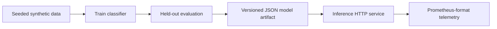

# Synthetic Fraud-Scoring Model Lifecycle

An independent local MLOps portfolio exercise. It trains a small logistic classifier on 800 deterministic synthetic records and serves a versioned learning-only score. It never handles actual payments, customer data or financial decisions.



The artifact stores model version, feature names, seed, dataset hash and metrics. It is JSON rather than executable serialization. The model exposes only normalized synthetic features in [0,1].

## Run locally

```bash
python3 -W error -m unittest -v
python3 model.py
python3 serve.py
```

In another terminal:

```bash
curl http://127.0.0.1:8080/healthz
curl -H 'Content-Type: application/json' -d '{"features":[0.9,0.9,0.9]}' http://127.0.0.1:8080/predict
curl http://127.0.0.1:8080/metrics
```

Or `docker build -t synthetic-fraud:local .` and `docker run --rm -p 127.0.0.1:8080:8080 synthetic-fraud:local`.

## Local Kubernetes

```bash
kind create cluster --name fraud-lab --image kindest/node:v1.34.3 --kubeconfig ./fraud-lab.kubeconfig
kind load docker-image --name fraud-lab synthetic-fraud:local
kubectl --kubeconfig ./fraud-lab.kubeconfig create namespace ml-lab
kubectl --kubeconfig ./fraud-lab.kubeconfig -n ml-lab apply -f k8s.yaml
kubectl --kubeconfig ./fraud-lab.kubeconfig -n ml-lab rollout status deployment/synthetic-fraud
kubectl --kubeconfig ./fraud-lab.kubeconfig -n ml-lab port-forward service/synthetic-fraud 18086:8080
```

Use the same endpoints at port 18086. If ARM64 image loading fails, export with `docker image save --platform linux/arm64 -o fraud-api.tar synthetic-fraud:local` and use `kind load image-archive --name fraud-lab fraud-api.tar`. Clean up with `kind delete cluster --name fraud-lab --kubeconfig ./fraud-lab.kubeconfig`.

## Evidence and limitations

26 November 2026: three strict tests passed, including deterministic training, invalid-input rejection, HTTP and telemetry; local Docker inference and metrics passed. The Kind v1.34.3 deployment reached Ready and returned a synthetic score and Prometheus-format counters through the ClusterIP service. On the 160 held-out synthetic rows: accuracy 95.625%, precision 93.056%, recall 97.101%. These figures are only for an intentionally generated educational dataset, not evidence of real fraud detection. MLflow, model registry promotion, KServe, production data governance, drift monitoring and GitOps remain separate future milestones.
